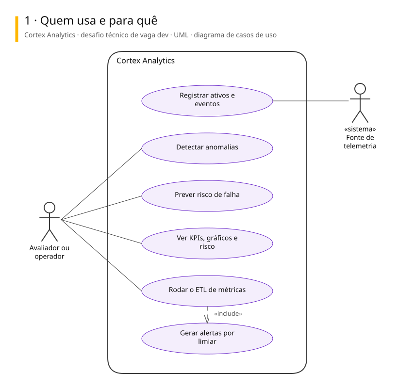
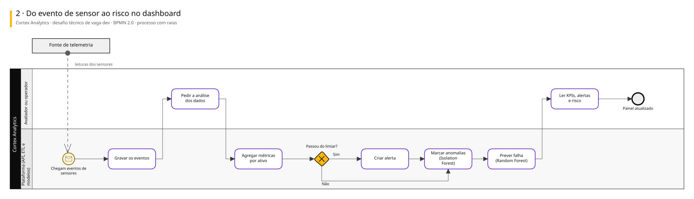
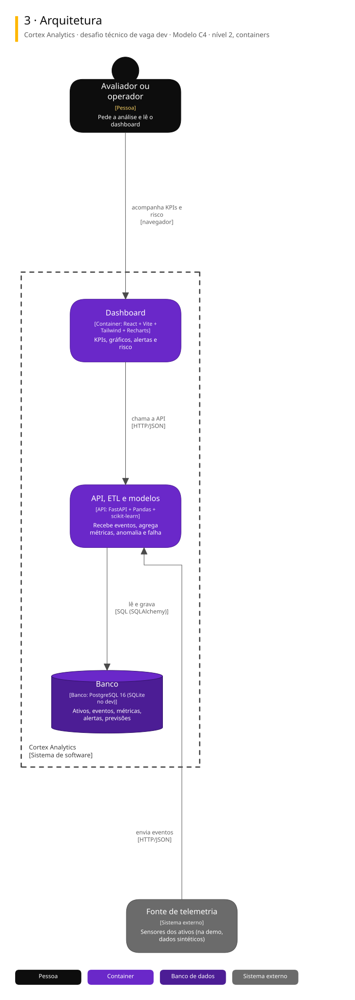

# Arquitetura

Três vistas do sistema, cada uma numa notação padrão.

| Vista | Notação | Responde |
|---|---|---|
| 1. Casos de uso | UML | Quem usa e para quê |
| 2. Processo | BPMN 2.0 | Como o trabalho anda, com uma raia para cada quem executa |
| 3. Arquitetura | C4, nível 2 | De que partes o sistema é feito e com quem conversa |

## Cortex Analytics · desafio técnico de vaga dev

Plataforma analítica full-stack feita como desafio técnico: ingere telemetria de ativos, roda um ETL em Pandas e modelos de scikit-learn para anomalia e risco de falha, e mostra tudo num dashboard React. Sobe com docker-compose.

### 1. Quem usa e para quê

### 2. Do evento de sensor ao risco no dashboard

### 3. Arquitetura

Para editar: [cortex-analytics.excalidraw](./cortex-analytics.excalidraw), que abre em [excalidraw.com](https://excalidraw.com) ou na extensão Excalidraw do VS Code.

## De onde vêm

Os diagramas são gerados a partir do Sinapse, o vault onde o Pedro organiza notas e projetos. Mudança feita direto aqui some na próxima publicação: o lugar de mudar é a especificação no Sinapse.
