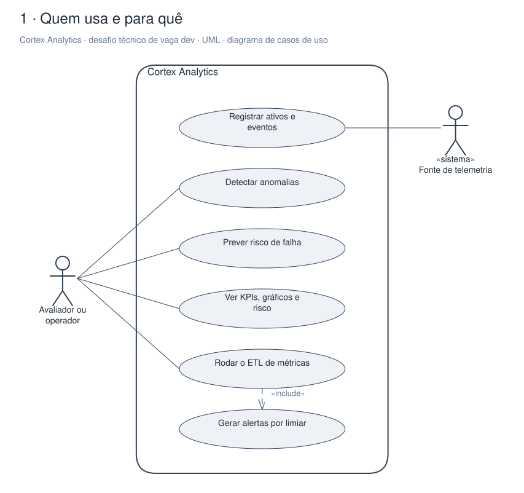
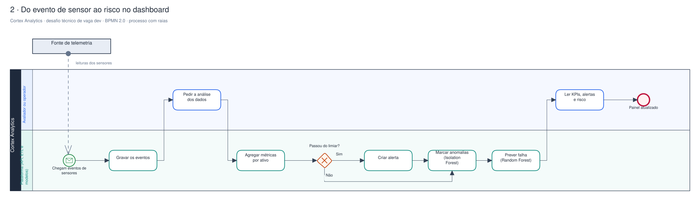
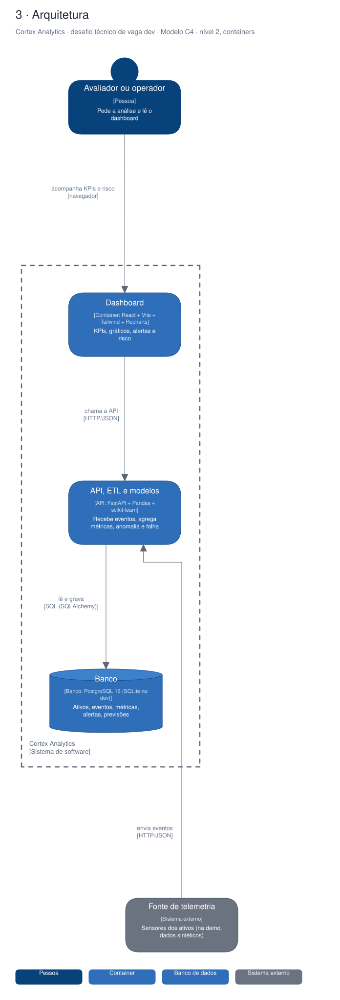

# Arquitetura

Diagramas gerados a partir do Sinapse (o segundo cérebro do Pedro). Cada projeto tem três vistas,
cada uma numa notação padrão:

1. **Quem usa e para quê**: UML, diagrama de casos de uso.
2. **O processo principal**: BPMN 2.0, com raias por quem executa.
3. **A arquitetura**: modelo C4, nível 2 (containers).

## Cortex Analytics · desafio técnico de vaga dev

Plataforma analítica full-stack feita como desafio técnico: ingere telemetria de ativos, roda um ETL em Pandas e modelos de scikit-learn para anomalia e risco de falha, e mostra tudo num dashboard React. Sobe com docker-compose.

### Quem usa e para quê (UML)

### Do evento de sensor ao risco no dashboard (BPMN 2.0)

### Arquitetura (C4, containers)

Editável: [`desafio-tecnico-dev-.excalidraw`](./desafio-tecnico-dev-.excalidraw), abre em [excalidraw.com](https://excalidraw.com) ou no VS Code com a extensão Excalidraw.

A fonte destes arquivos é o vault do Sinapse (`09-DESENHOS/`); alterações feitas aqui são sobrescritas na próxima publicação.
